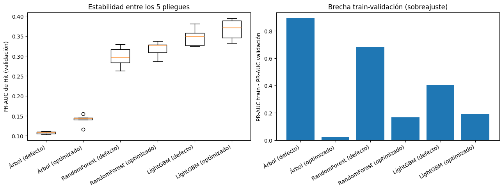
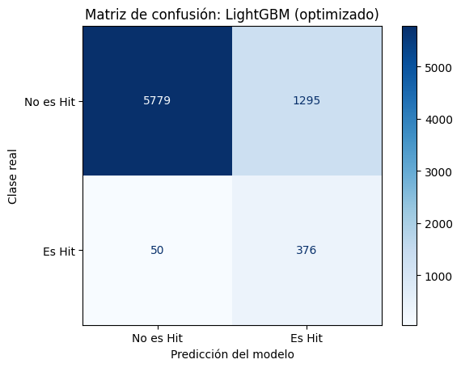
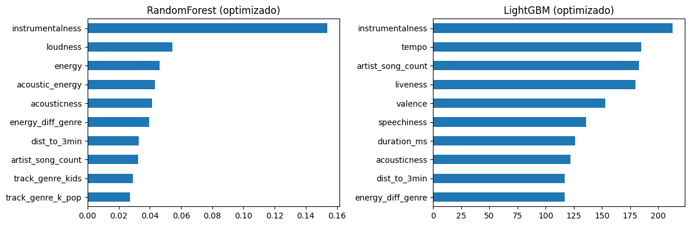

# Informe técnico: Inteligencia musical y predicción de popularidad de canciones (Spotify Tracks)

**Evaluación Parcial N°3 · Machine Learning (MLY1101) · Duoc UC**

| Campo | Detalle |
| :---- | :---- |
| Integrantes | Catalina Villegas y Javiera Fuenzalida |
| Sección | 002D |
| Docente | Ignacio Meza |
| Caso | C: Inteligencia musical y predicción de popularidad de canciones |

---

## 1\. Descripción del problema de negocio

Las plataformas de streaming reciben miles de canciones nuevas cada día. Para discográficas, creadores de contenido y la propia plataforma, anticipar cuáles canciones pueden ser un éxito permite decidir dónde invertir en marketing y qué canciones incluir en listas editoriales.

El problema se plantea como una **clasificación binaria**: dada una canción, predecir si será **hit** (`popularity >= 70`) o no. Como solo una pequeña parte del catálogo son hits, el modelo se usa como **filtro de candidatos** para priorizar la revisión humana, no como una decisión automática.

## 2\. Objetivos del proyecto

**Objetivo general:** construir un modelo que prediga si una canción será hit a partir de sus atributos de audio y metadatos.

**Objetivos específicos:**

1. Comparar un árbol de decisión simple contra dos ensambles: Random Forest (bagging) y LightGBM (boosting).  
2. Optimizar los hiperparámetros con Grid Search y Random Search.  
3. Evaluar la capacidad de generalización con validación cruzada de 5 pliegues.  
4. Seleccionar el mejor modelo con criterios cuantitativos.  
5. Descubrir perfiles sonoros de canciones con K-Means.

## 3\. Definición de KPIs

Los KPI 1 a 4 son descriptivos y se miden en el EDA. Los KPI 5 a 13 evalúan los modelos y sus metas se fijaron **antes** de ejecutar la validación cruzada.

| N° | KPI | Definición | Meta |
| :---- | :---- | :---- | :---- |
| 1 | Tasa global de hits | % de canciones con `popularity >= 70` | Referencia del azar |
| 2 | Hit ratio por género | % de hits dentro de cada género | Identificar los 5 géneros con mayor hit ratio |
| 3 | Índice de afinidad sonora | Correlación entre atributos de audio y popularidad | Medido en el EDA |
| 4 | Duración óptima | Intervalo de duración con mayor popularidad promedio | Medido en el EDA |
| 5 | Recall de Hit | Hits reales que el modelo detecta (test) | \>= 0,60 |
| 6 | Lift de precisión | Precision de Hit / tasa de hits del test | \>= 3 |
| 7 | PR-AUC en validación cruzada | Calidad del ranking de hits | \>= 3 veces el azar |
| 8 | Estabilidad | Desviación estándar de PR-AUC entre los 5 pliegues | \<= 0,02 |
| 9 | Brecha train-validación | PR-AUC train menos PR-AUC validación | Menor que la del modelo por defecto |
| 10 | Aporte de la optimización | PR-AUC optimizado menos PR-AUC por defecto | \>= \+0,01 en al menos un ensamble |
| 11 | Aporte del ensamble | PR-AUC del mejor ensamble menos el del árbol simple | \>= \+0,05 |
| 12 | Latencia | Milisegundos para predecir 1.000 canciones | \<= 1.000 |
| 13 | Equidad | Diferencia de recall entre artistas vistos y nuevos | \<= 0,20 |

## 4\. Descripción de las fuentes de datos

* **Fuente original:** `Spotify_Tracks_Dataset.csv`, con 114.000 filas, 114 géneros y 20 variables (más un índice). Contiene 89.741 canciones distintas, porque una misma canción aparece en varios géneros.  
* **Dataset de trabajo:** `Spotify_Tracks_Dataset_Clean.csv`, generado por el notebook del EDA (`EDA.ipynb`): 42.409 filas, 50 géneros y 32 columnas.  
* **Variables principales:**  
  * Audio: `danceability`, `energy`, `loudness`, `speechiness`, `acousticness`, `instrumentalness`, `liveness`, `valence`, `tempo`, `duration_ms`.  
  * Metadatos: `explicit`, `key`, `mode`, `time_signature`, `track_genre`, `artists`.  
  * Calculadas en el EDA: `is_collab`, `artist_song_count`, `party_index`, `dist_to_3min`, `acoustic_energy` y diferencias de cada atributo respecto del promedio de su género.  
* **Variable objetivo:** `is_hit` (1 si `popularity >= 70`).

## 5\. Preparación y análisis exploratorio de los datos (EDA)

### 5.1 Calidad de los datos (dataset original)

| Hallazgo | Cantidad |
| :---- | :---- |
| Filas con `popularity = 0` | 16.020 |
| Filas duplicadas exactas | 450 |
| Valores nulos | 1 en `artists`, 1 en `album_name` y 1 en `track_name` (misma fila) |
| `tempo = 0` | 157 |
| `time_signature = 0` | 163 |

### 5.2 Tratamiento (notebook del EDA)

* Se eliminan las canciones con `popularity = 0`, los duplicados exactos y la fila con nulos.  
* `tempo` y `time_signature` iguales a 0 se reemplazan por la mediana.  
* Se crean variables nuevas (colaboraciones, cantidad de canciones por artista, interacciones entre atributos y diferencias respecto del género).  
* **Selección de géneros:** se conservan los **25 géneros con mayor popularidad promedio y los 25 con menor popularidad promedio**, para tener contraste entre géneros populares y no populares.  
* Los datos limpios se guardan en `Spotify_Tracks_Dataset_Clean.csv`.

### 5.3 Preparación para el modelamiento (`EvParcial3_MachineLearning_VillegasFuenzalida.ipynb`)

1. **Una fila por canción** (`drop_duplicates` por `track_id`): evita que la misma canción quede en train y en test. Quedan **37.497 canciones** de **49 géneros**.  
2. Se crea `is_hit`. La tasa global de hits es **5,68 %** (2.128 hits), así que un modelo que siempre responda "No Hit" tendría 94,3 % de exactitud. Por eso la exactitud no sirve como métrica.  
3. Se eliminan `popularity` (revela la respuesta), `track_id`, `artists` y las columnas de texto.  
4. Género y tonalidad (`key`) se convierten en columnas 0/1 con `pd.get_dummies`. Quedan **83 variables**.  
5. Partición **80 % train (29.997 filas) / 20 % test (7.500 filas)**, estratificada por `is_hit`: 5,67 % de hits en train y 5,68 % en test.  
6. El desbalance (16,6 canciones No Hit por cada Hit en train) se compensa con **pesos de clase**, sin crear datos sintéticos.  
7. No se escalan las variables en clasificación, porque los modelos basados en árboles no lo necesitan.

### 5.4 Patrones principales (KPI 1 a 4\)

Valores calculados sobre las 37.497 canciones únicas.

* **KPI 1, tasa global de hits:** 5,68 %. 16 de los 49 géneros no tienen ningún hit.  
* **KPI 2, géneros con mayor hit ratio:** electro (39,59 %), pop (39,36 %), house (32,64 %), indie (32,35 %) y edm (28,69 %).  
* **KPI 3, afinidad sonora:** las correlaciones de los atributos con `popularity` son débiles. La más fuerte es `instrumentalness` (-0,26); le siguen `loudness` (+0,11), `speechiness` (-0,10), `duration_ms` (-0,09), `liveness` (-0,09) y `danceability` (+0,08). Ningún atributo alcanza \|r\| \= 0,30, así que el sonido por sí solo explica poco del éxito.  
* **KPI 4, duración óptima:** el intervalo de 3 a 5 minutos tiene la mayor popularidad promedio (37,4 puntos) y la mayor tasa de hits (7,6 %). Las canciones de menos de 2 minutos tienen 27,1 puntos (1,3 % de hits) y las de 6 a 10 minutos, 23,1 puntos (1,3 % de hits).

## 6\. Metodología utilizada (CRISP-DM)

| Fase | Qué se hizo |
| :---- | :---- |
| 1\. Comprensión del negocio | Problema, objetivos y KPIs (secciones 1 a 3\) |
| 2\. Comprensión de los datos | Exploración de calidad, distribuciones, correlaciones y KPIs descriptivos (sección 5\) |
| 3\. Preparación de los datos | Limpieza en el EDA; una fila por canción, codificación y partición en `EvParcial3_MachineLearning_VillegasFuenzalida.ipynb` |
| 4\. Modelado | Árbol de decisión, Random Forest, LightGBM y K-Means |
| 5\. Evaluación | Validación cruzada de 5 pliegues, métricas en test, equidad y tabla de KPIs |
| 6\. Despliegue | Notebooks reproducibles, este informe y el `README.md` |

7\. Desarrollo de los modelos de aprendizaje automático

Se comparan tres modelos supervisados de clasificación y un modelo no supervisado.

| Modelo | Tipo | Idea principal |
| :---- | :---- | :---- |
| Árbol de decisión | Modelo simple (referencia) | Un solo árbol; es fácil de interpretar pero tiende a sobreajustar |
| Random Forest | Ensamble: **bagging** | Muchos árboles entrenados en paralelo con muestras aleatorias; reduce la varianza |
| LightGBM | Ensamble: **boosting** | Árboles en secuencia, cada uno corrige los errores del anterior; reduce el sesgo |
| K-Means | No supervisado | Agrupa canciones por similitud sonora |

Todos los modelos supervisados usan pesos de clase (`class_weight` o `scale_pos_weight`) por el desbalance.

### 7.1 K-Means: perfiles sonoros

Se usan solo los 9 atributos de audio (`danceability`, `energy`, `loudness`, `speechiness`, `acousticness`, `instrumentalness`, `liveness`, `valence`, `tempo`), escalados con `StandardScaler`, sin `popularity`, `is_hit`, artista ni género. Así los grupos reflejan el sonido y no la variable objetivo.

El coeficiente de silueta es máximo con k \= 2 (0,246), pero esa solución solo separa canciones suaves de intensas. Entre k \= 3 y k \= 8 la silueta más alta es la de **k \= 7** (0,196). La silueta baja indica que los grupos se traslapan, algo esperable en un continuo musical.

| Grupo | Canciones | Tasa de hits | Popularidad media | Perfil sonoro | Géneros típicos |
| :---- | :---- | :---- | :---- | :---- | :---- |
| 0 | 5.210 | 1 % | 22,8 | Instrumental y enérgico, sin voz ni acústica | detroit-techno, study, chicago-house |
| 1 | 7.556 | 6 % | 37,7 | Acústico y suave: baja energía, alta acústica | tango, honky-tonk, chill |
| 2 | 7.733 | 6 % | 37,2 | Intenso: máxima energía y tempo alto, poco bailable | heavy-metal, grunge, black-metal |
| 3 | 856 | 0 % | 23,3 | Hablado y en vivo: alta speechiness y liveness | comedy, kids, sad |
| 4 | 3.054 | 1 % | 29,8 | Instrumental, acústico y muy bajo en volumen y energía | piano, disney, classical |
| 5 | 2.048 | 4 % | 31,6 | En vivo y enérgico | heavy-metal, happy, grindcore |
| 6 | 11.040 | 9 % | 38,9 | Positivo y bailable: alta valence y danceability | kids, j-dance, k-pop |

La tasa de hits va de 0 % a 9 %, frente a 5,68 % del total. El grupo 6 es el más favorable, pero ningún grupo se acerca al nivel de los géneros con mayor hit ratio: el perfil sonoro por sí solo no determina que una canción sea hit.

## 8\. Optimización de hiperparámetros y técnicas de ensamble

### 8.1 Qué se optimizó y con qué estrategia

Un **hiperparámetro** lo define el ingeniero antes de entrenar; un **parámetro** lo aprende el modelo. Todas las búsquedas usan validación cruzada de 3 pliegues estratificada, solo sobre train, y optimizan **PR-AUC** (`average_precision`).

| Modelo | Estrategia | Espacio de búsqueda | Combinaciones | Mejor combinación | PR-AUC | Tiempo |
| :---- | :---- | :---- | :---- | :---- | :---- | :---- |
| Árbol simple | Grid Search | `max_depth` \[3, 5, 8\]; `min_samples_leaf` \[20, 50\] | 6 (todas) | `max_depth` 8, `min_samples_leaf` 20 | 0,143 | 16 s |
| Random Forest | Random Search | `n_estimators` \[100, 150\]; `max_depth` \[8, 12, 16\]; `min_samples_leaf` \[5, 10, 20\]; `max_features` \['sqrt', 0,3\] | 6 de 36 | 150 árboles, `max_depth` 16, `min_samples_leaf` 20, `max_features` 0,3 | 0,305 | 222 s |
| LightGBM | Random Search | `n_estimators` \[100, 200, 300\]; `learning_rate` \[0,03, 0,05, 0,1\]; `num_leaves` \[15, 31, 63\]; `max_depth` \[4, 6, 8\]; `min_child_samples` \[20, 50, 100\] | 8 de 243 | 300 árboles, `learning_rate` 0,05, `num_leaves` 15, `max_depth` 8, `min_child_samples` 50 | 0,349 | 34 s |

**Por qué estas estrategias:**

* El **árbol** tiene pocos hiperparámetros y pocos valores, así que Grid Search puede probar todas las combinaciones.  
* **Random Forest** y **LightGBM** tienen espacios más grandes. Grid Search crecería de forma exponencial (243 combinaciones solo en LightGBM), por lo que Random Search fija el presupuesto con `n_iter` y suele encontrar resultados similares en una fracción del tiempo.  
* Los rangos se acotaron con criterio técnico (por ejemplo, limitar la profundidad para evitar que un árbol memorice ruido) para reducir el tiempo de cómputo.  
* Random Forest fue la búsqueda más costosa (222 s), aunque probó menos combinaciones que LightGBM, porque entrena cientos de árboles profundos en cada ajuste.

### 8.2 Efecto de la optimización

Resultados de la validación cruzada de 5 pliegues (PR-AUC en validación):

| Modelo | Por defecto | Optimizado | Mejora | Brecha train-val (defecto → optimizado) |
| :---- | :---- | :---- | :---- | :---- |
| Árbol de decisión | 0,108 | 0,140 | \+0,032 | 0,890 → 0,024 |
| Random Forest | 0,298 | 0,318 | \+0,020 | 0,681 → 0,165 |
| LightGBM | 0,348 | 0,367 | \+0,019 | 0,405 → 0,190 |

La optimización mejora el desempeño en los tres modelos y **reduce de forma importante la brecha entre train y validación**, es decir, el sobreajuste. El aporte en PR-AUC es pequeño en los ensambles (+0,02), pero supera la meta del KPI 10 (+0,01).

### 8.3 Aporte de los ensambles

| Modelo | PR-AUC en validación | Diferencia con el árbol simple optimizado |
| :---- | :---- | :---- |
| Árbol simple (optimizado) | 0,140 | — |
| Random Forest (bagging) | 0,318 | \+0,178 |
| LightGBM (boosting) | 0,367 | \+0,227 |

Combinar muchos árboles mejora el ranking de hits entre 2,3 y 2,6 veces frente al árbol simple. Esto coincide con la teoría: el árbol solo es inestable y limitado; el **bagging** reduce la varianza y el **boosting** corrige errores paso a paso. En este problema el boosting rinde mejor que el bagging.

## 9\. Evaluación de resultados mediante métricas apropiadas

Con solo 5,68 % de hits se usan **PR-AUC, recall y matriz de confusión** como métricas principales. La referencia del azar para PR-AUC es 0,057 (la tasa de hits).

### 9.1 Generalización: validación cruzada de 5 pliegues

| Modelo | PR-AUC val (media) | Desv. | PR-AUC train | ROC-AUC val | Recall val | Precision val | F1 val | Brecha |
| :---- | :---- | :---- | :---- | :---- | :---- | :---- | :---- | :---- |
| Árbol (defecto) | 0,108 | 0,003 | 0,998 | 0,606 | 0,259 | 0,249 | 0,254 | 0,890 |
| Árbol (optimizado) | 0,140 | 0,013 | 0,164 | 0,771 | 0,854 | 0,124 | 0,216 | 0,024 |
| Random Forest (defecto) | 0,298 | 0,024 | 0,978 | 0,883 | 0,076 | 0,352 | 0,125 | 0,681 |
| Random Forest (optimizado) | 0,318 | 0,018 | 0,483 | 0,873 | 0,764 | 0,191 | 0,306 | 0,165 |
| LightGBM (defecto) | 0,348 | 0,021 | 0,752 | 0,908 | 0,773 | 0,254 | 0,382 | 0,405 |
| LightGBM (optimizado) | 0,367 | 0,024 | 0,557 | 0,912 | 0,855 | 0,224 | 0,355 | 0,190 |

**Lectura:**

* **Sobreajuste:** el árbol por defecto aprende casi perfecto en train (PR-AUC 0,998) y rinde 0,108 en validación; es memorización. Random Forest por defecto también sobreajusta (brecha 0,681). La optimización reduce esas brechas.  
* **Estabilidad:** las desviaciones estándar entre pliegues son bajas (0,013 a 0,024). Random Forest optimizado es el más estable entre los ensambles (0,018); LightGBM optimizado tiene 0,024, apenas sobre la meta de 0,02.  
* **Brecha residual:** los ensambles optimizados mantienen una brecha de 0,17 a 0,19. Aún hay algo de sobreajuste, aunque mucho menor que con los valores por defecto.  
* El árbol optimizado casi no tiene brecha (0,024), pero porque es demasiado simple: rinde poco tanto en train como en validación (subajuste).

### 9.2 Desempeño en el conjunto de test (se usa una sola vez)

| Modelo | Precision Hit | Recall Hit | F1 Hit | ROC-AUC | PR-AUC | Hits detectados | Hits perdidos | Falsas alarmas | Lift vs azar | Latencia (ms por 1.000 canciones) |
| :---- | :---- | :---- | :---- | :---- | :---- | :---- | :---- | :---- | :---- | :---- |
| Árbol (optimizado) | 0,143 | 0,822 | 0,244 | 0,803 | 0,167 | 350 | 76 | 2.095 | 2,52 | 0,95 |
| Random Forest (optimizado) | 0,189 | 0,770 | 0,303 | 0,885 | 0,354 | 328 | 98 | 1.411 | 3,32 | 14,86 |
| **LightGBM (optimizado)** | **0,225** | **0,883** | **0,359** | **0,921** | **0,392** | **376** | **50** | **1.295** | **3,96** | **10,94** |

El test tiene 426 hits reales de 7.500 canciones. El PR-AUC de LightGBM en test (0,392) es coherente con el de validación cruzada (0,367), lo que indica que el modelo generaliza.

### 9.3 Matriz de confusión del modelo seleccionado

|  | Predicho No Hit | Predicho Hit |
| :---- | :---- | :---- |
| **Real No Hit** | 5.779 | 1.295 (falsas alarmas) |
| **Real Hit** | 50 (hits perdidos) | 376 (hits detectados) |

* El modelo detecta **88,3 % de los hits** (recall 0,883) y pierde solo 50\.  
* A cambio, de cada 100 alertas solo unas 22 son hits reales (precision 0,225). La exactitud global es 0,82.  
* Esto es lo esperable al ponderar la clase minoritaria: se prioriza no perder hits a costa de más falsos positivos.

### 9.4 Variables más importantes

En ambos ensambles la variable más importante es `instrumentalness` (las canciones muy instrumentales tienden a no ser hits, coherente con su correlación negativa). Aparecen también `loudness`, `energy`, `acoustic_energy`, `tempo`, `liveness`, `valence` y `artist_song_count` (cuántas canciones tiene el artista en el dataset), además de algunos géneros como `kids` y `k_pop`.

### 9.5 Equidad por subgrupos

| Subgrupo | Canciones | Hits reales | Tasa de alertas | Recall Hit | Precision Hit |
| :---- | :---- | :---- | :---- | :---- | :---- |
| Artista visto en train | 5.562 | 284 | 0,220 | 0,884 | 0,205 |
| Artista nuevo | 1.938 | 142 | 0,230 | 0,880 | 0,280 |
| Contenido explícito | 719 | 71 | 0,323 | 0,873 | 0,267 |
| Sin contenido explícito | 6.781 | 355 | 0,212 | 0,885 | 0,218 |

El recall es prácticamente igual en todos los subgrupos (diferencia de 0,004 entre artistas vistos y nuevos). Una diferencia a vigilar: el modelo marca como posible hit al 32,3 % de las canciones explícitas frente a 21,2 % de las no explícitas.

### 9.6 Cumplimiento de los KPIs

| N° | KPI | Valor | Meta | ¿Cumple? |
| :---- | :---- | :---- | :---- | :---- |
| 5 | Recall de Hit (test) | 0,883 | \>= 0,60 | Sí |
| 6 | Lift de precisión (test) | 3,96 | \>= 3 | Sí |
| 7 | PR-AUC en validación cruzada | 0,367 | \>= 0,170 (3 veces el azar) | Sí |
| 8 | Desviación estándar de PR-AUC | 0,024 | \<= 0,02 | **No** |
| 9 | Brecha train-validación | 0,190 | \< 0,405 (defecto) | Sí |
| 10 | Aporte de la optimización | \+0,020 | \>= \+0,01 | Sí |
| 11 | Aporte del ensamble | \+0,227 | \>= \+0,05 | Sí |
| 12 | Latencia (ms por 1.000 canciones) | 10,94 | \<= 1.000 | Sí |
| 13 | Diferencia de recall visto vs nuevo | 0,004 | \<= 0,20 | Sí |

Se cumplen 8 de 9 KPIs. La estabilidad queda levemente sobre la meta (0,024 frente a 0,02).

## 10\. Selección y justificación de la solución analítica

**Regla de decisión (fijada antes de usar el test):** entre los modelos optimizados, se elige el de mayor PR-AUC medio en validación cruzada; luego se verifican su estabilidad, brecha, latencia y equidad.

| Criterio | Árbol simple | Random Forest | LightGBM |
| :---- | :---- | :---- | :---- |
| PR-AUC validación (media) | 0,140 | 0,318 | **0,367** |
| Estabilidad (desv.) | 0,013 | **0,018** | 0,024 |
| Brecha train-validación | **0,024** | 0,165 | 0,190 |
| Recall / precision en test | 0,822 / 0,143 | 0,770 / 0,189 | **0,883 / 0,225** |
| PR-AUC en test | 0,167 | 0,354 | **0,392** |
| Latencia (ms por 1.000 canciones) | **0,95** | 14,86 | 10,94 |
| Complejidad | 1 árbol | 150 árboles en paralelo | 300 árboles en secuencia |

**Modelo seleccionado: LightGBM optimizado.**

* Tiene el mayor PR-AUC en validación cruzada y en test. Su ventaja sobre Random Forest (0,049) es cercana al doble de la desviación estándar entre pliegues, por lo que no es solo ruido.  
* Detecta más hits (recall 0,883) y tiene la mejor precision y el mejor lift (3,96 veces el azar).  
* Sus costos son aceptables: una latencia de 10,9 ms por cada 1.000 canciones y un entrenamiento de segundos.  
* Sus puntos débiles son una estabilidad algo menor que Random Forest (0,024 frente a 0,018) y una brecha residual de 0,19. Además, es más difícil de explicar que un solo árbol y requiere más ajuste fino de hiperparámetros.  
* **Alternativa:** si el negocio prioriza la estabilidad y la facilidad de mantención por sobre el desempeño, Random Forest es una opción razonable, con una pérdida de 0,05 en PR-AUC.  
* El árbol simple queda descartado: su desempeño es muy inferior y no cumple la meta de aporte del ensamble.

## 11\. Análisis de sesgos, limitaciones y consideraciones éticas

**Sesgos de los datos**

* **Selección de géneros:** el dataset contiene los 25 géneros más populares y los 25 menos populares según su popularidad promedio. Esta selección usa la variable que luego se predice y no refleja el catálogo real; la tasa de hits (5,68 %) y la importancia de ciertos géneros dependen de ella. 16 de los 49 géneros no tienen ningún hit.  
* **Sesgo de retroalimentación:** la popularidad refleja lo que Spotify ya promovió en sus listas, así que el modelo tiende a repetir esas decisiones y a favorecer lo que ya es popular.  
* **Una fila por canción:** al conservar un solo género por canción se pierde información de géneros múltiples.  
* **Popularidad puntual:** `popularity` es una medida en un momento dado; no considera la antigüedad de la canción ni cambios de tendencia.

**Limitaciones del modelo**

* La **precision es baja** (0,225): aproximadamente 3 de cada 4 alertas son falsas. El modelo no debe usarse para decidir sin revisión humana.  
* El umbral de decisión es 0,5. Un umbral distinto cambiaría el equilibrio entre recall y precision.  
* La **estabilidad (0,024) y la brecha (0,19)** muestran que aún hay algo de sobreajuste.  
* El conteo de canciones por artista (`artist_song_count`) y las diferencias respecto del género se calcularon en el EDA con todo el dataset (sin usar la variable objetivo), antes de dividir en train y test. Es una fuga menor de información.  
* La partición es aleatoria entre artistas: 74 % de las canciones de test pertenecen a artistas que aparecen en train. La equidad entre artistas vistos y nuevos mostró un desempeño similar, pero conviene validarlo con más datos.  
* Los hiperparámetros se buscaron con búsquedas acotadas por tiempo de cómputo (Google Colab); un espacio más amplio podría mejorar algo el resultado.

**Ética y privacidad**

* El dataset contiene metadatos públicos de canciones, sin datos personales de oyentes. No hay información personal identificable.  
* El modelo debe usarse como **herramienta de apoyo** para productores y equipos de marketing, evitando descartar obras de valor artístico solo porque su perfil sonoro se aleje del estándar comercial dominante.  
* El modelo marca más canciones explícitas como posibles hits (32,3 % frente a 21,2 %), aunque su recall es similar. Se recomienda monitorear esta diferencia para evitar sesgos hacia o contra ciertos contenidos.

## 12\. Conclusiones y recomendaciones para el negocio

**Conclusiones**

1. Los **ensambles superan con claridad al árbol simple**: el PR-AUC pasa de 0,140 a 0,318 (Random Forest) y 0,367 (LightGBM). El boosting rinde mejor que el bagging en este problema.  
2. La **optimización de hiperparámetros** mejora el rendimiento (+0,02 en PR-AUC en los ensambles) y reduce el sobreajuste de forma importante: la brecha del árbol baja de 0,890 a 0,024 y la de LightGBM de 0,405 a 0,190.  
3. El modelo seleccionado, **LightGBM optimizado**, detecta el 88,3 % de los hits con un lift de 3,96 veces el azar, y generaliza (PR-AUC 0,367 en validación cruzada y 0,392 en test).  
4. El sonido por sí solo explica poco del éxito: las correlaciones con la popularidad son débiles y los perfiles sonoros encontrados con K-Means tienen tasas de hits entre 0 % y 9 %.

**Recomendaciones**

* **Usar el modelo como filtro de candidatos.** Con el modelo seleccionado, revisar el 22,3 % del catálogo (las canciones marcadas) permite capturar el 88,3 % de los hits, frente al 22 % que se capturaría al azar con la misma cantidad de revisiones. Es una forma de ahorrar tiempo de revisión humana, no de reemplazarla.  
* **Elegir el umbral según el costo del error.** Si perder un hit es más costoso que revisar de más, mantener el umbral actual (alto recall). Si la revisión es costosa, subir el umbral para ganar precision.  
* **Segmentar campañas y listas** según los perfiles sonoros (por ejemplo, el grupo 6 positivo y bailable tiene la mayor tasa de hits), sin esperar que el perfil sonoro por sí solo prediga el éxito.  
* **Priorizar la duración de 3 a 5 minutos**, que concentra la mayor popularidad y la mayor tasa de hits.  
* **Reentrenar periódicamente** el modelo y repetir la búsqueda de hiperparámetros, porque los gustos de los oyentes cambian.  
* **Próximos pasos:** probar umbrales alternativos, agregar variables de contexto (fecha de lanzamiento, tendencia del artista) y validar con un conjunto que incluya artistas completamente nuevos.

---

## Anexo: archivos del proyecto

| Archivo | Contenido |
| :---- | :---- |
| `notebooks/EDA.ipynb` | Limpieza, análisis exploratorio y KPIs descriptivos |
| `notebooks/EvParcial3_MachineLearning_VillegasFuenzalida.ipynb` | Preparación, optimización, ensambles, validación cruzada, selección y K-Means |
| `data/Spotify_Tracks_Dataset.csv` | Datos originales |
| `data/Spotify_Tracks_Dataset_Clean.csv` | Datos limpios usados en el modelado |
| `images/` | Gráficos generados por los notebooks |

&nbsp;